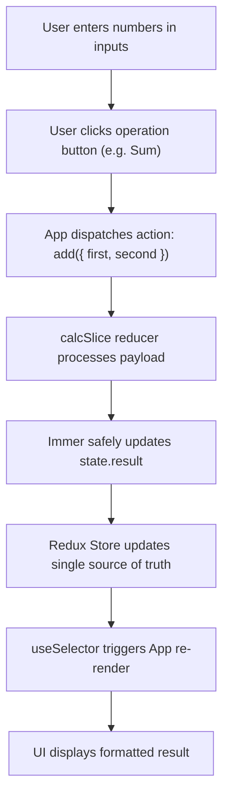

# 🧮 Redux Toolkit Interactive Calculator

[](https://react.dev/)
[](https://redux-toolkit.js.org/)
[](https://vitejs.dev/)
[](https://developer.mozilla.org/en-US/docs/Web/JavaScript)
[](LICENSE)

A clean, responsive, and predictable arithmetic calculator built with **React 19** and **Redux Toolkit (RTK)**. This project was developed to demonstrate a strong mastery of modern frontend fundamentals, centralized state container architecture, unidirectional data flow, and clean separation of concerns.

---

## 📌 Table of Contents
- [Overview](#-overview)
- [✨ Key Features](#-key-features)
- [🏗️ State Management Architecture](#️-state-management-architecture)
- [🔄 Unidirectional Data Flow](#-unidirectional-data-flow)
- [📂 Project Structure](#-project-structure)
- [🧠 Concepts & Best Practices Demonstrated](#-concepts--best-practices-demonstrated)
- [🚀 Getting Started](#-getting-started)
- [🛠️ Tech Stack](#️-tech-stack)

---

## 📖 Overview

In modern web development, managing state efficiently is essential. While local component state (`useState`) works well for isolated inputs, complex business logic and shared data benefit greatly from a centralized store.

This calculator demonstrates the hybrid state pattern:
1. **Local State (`useState`)**: Manages immediate user keystrokes in input fields.
2. **Global State (`Redux Toolkit`)**: Executes arithmetic operations, encapsulates validation rules (such as division-by-zero checks), and stores the single source of truth for the calculation result.

---

## ✨ Key Features

- **Standard Arithmetic Operations**: Addition (`+`), Subtraction (`-`), Multiplication (`*`), and Division (`/`).
- **Defensive Error Handling**: Prevents division by zero or invalid inputs with clear user-friendly feedback (`"Division by zero or an invalid number is not possible."`).
- **Dynamic Payload Passing**: Dispatches input numbers through `action.payload` for dynamic calculations.
- **Synchronized Reset**: Clears both the Redux state (`result = null`) and resets local input fields with a single click.
- **Modern Responsive Design**: Built with pure CSS using CSS Grid, Flexbox, smooth hover micro-animations, and mobile responsiveness.

---

## 🏗️ State Management Architecture

The application is structured using **Redux Toolkit (RTK)**, which solves classic Redux boilerplate issues while enforcing best practices out of the box.

```
┌─────────────────────────────────────────────────────────────┐
│                       Redux Store                           │
│  ┌───────────────────────────────────────────────────────┐  │
│  │                    calcSlice                          │  │
│  │  - initialState: { result: null }                     │  │
│  │  - Reducers: add, sub, mult, divi, reset              │  │
│  └───────────────────────────────────────────────────────┘  │
└─────────────────────────────────────────────────────────────┘
          ▲                                         │
          │ dispatch(action)                        │ useSelector
          │                                         ▼
┌─────────────────────────────────────────────────────────────┐
│                      React UI (App.jsx)                     │
│  - Controlled Inputs (useState)                             │
│  - Event Handlers (handleSumClick, handleResetClick, etc.)  │
└─────────────────────────────────────────────────────────────┘
```

### 1. Central Store Configuration (`src/app/store.js`)
Configured using `configureStore()`, which automatically sets up the Redux DevTools extension and sensible middleware:
```javascript
import { configureStore } from "@reduxjs/toolkit";
import calcReducer from "../features/calcs/calcSlice";

export const store = configureStore({
  reducer: {
    calc: calcReducer,
  },
});
```

### 2. Feature Slice (`src/features/calcs/calcSlice.js`)
Built with `createSlice()`, bundling action creators and reducers into one coherent domain:
- **Immutability with Immer**: Redux Toolkit utilizes Immer internally, allowing direct mutations like `state.result = first + second;` while maintaining pure immutable updates under the hood.
- **Safe Parsing**: Explicitly parses payload values into numbers using `Number()` before performing math.
- **Zero-Division Guard**: Protects against dividing by zero or NaN values using `Number.isFinite(second)`.

### 3. Component Integration (`src/App.jsx`)
- **`useSelector`**: Extracts `state.calc.result` and subscribes the component to store updates.
- **`useDispatch`**: Dispatches action creators (`add`, `sub`, `mult`, `divi`, `reset`) with an object payload `{ first, second }`.

---

## 🔄 Unidirectional Data Flow

The calculation lifecycle follows a strict one-way data flow:


---

## 📂 Project Structure

```text
Redux-Calculator/
├── public/                 # Static public assets
│   └── favicon.svg         # App favicon
├── src/
│   ├── app/
│   │   └── store.js        # Global Redux Store configuration
│   ├── features/
│   │   └── calcs/
│   │       └── calcSlice.js# Calculator slice (state, reducers, actions)
│   ├── App.css             # Component styling & responsiveness
│   ├── App.jsx             # Main UI component & event handlers
│   ├── index.css           # Global typography & root variables
│   └── main.jsx            # React root mount with Redux Provider
├── index.html              # HTML entry point
├── package.json            # Project dependencies & scripts
├── vite.config.js          # Vite build configuration
└── README.md               # Project documentation
```

---

## 🧠 Concepts & Best Practices Demonstrated

1. **Separation of Concerns**:
   - UI concerns (input rendering, button states) are kept separate from business logic (arithmetic rules, validation).
2. **Local vs. Global State Decision**:
   - Kept transient form state inside the component (`useState`) to prevent unnecessary store dispatches on every keystroke.
   - Delegated final business calculations to Redux to ensure predictable and inspectable updates.
3. **Controlled Form Inputs**:
   - Controlled inputs bound to React state ensuring values are always deterministic and easily cleared on reset.
4. **Action Creators & Payloads**:
   - Used structured payloads (`{ first, second }`) to keep actions expressive and easy to debug in Redux DevTools.
5. **Defensive Programming**:
   - Handled division edge cases before calculating to prevent `Infinity` or `NaN` from propagating to the UI.

---

## 🚀 Getting Started

### Prerequisites
Make sure you have **Node.js** (v18 or higher recommended) and **npm** installed on your machine.

### Installation

1. **Clone the repository:**
   ```bash
   git clone https://github.com/Ali-Tobar/redux-toolkit-calculator
   cd Redux-Calculator
   ```

2. **Install dependencies:**
   ```bash
   npm install
   ```

3. **Start the development server:**
   ```bash
   npm run dev
   ```
   Open your browser and navigate to `http://localhost:5173`.

4. **Build for production:**
   ```bash
   npm run build
   ```

5. **Preview production build:**
   ```bash
   npm run preview
   ```

---

## 🛠️ Tech Stack

- **Framework**: [React 19](https://react.dev/)
- **State Management**: [Redux Toolkit](https://redux-toolkit.js.org/) & [React-Redux](https://react-redux.js.org/)
- **Build Tool**: [Vite](https://vitejs.dev/)
- **Styling**: Vanilla CSS3 (Grid, Flexbox, CSS Variables)
- **Code Quality**: ESLint

---

## 👨‍💻 Author

Crafted as a demonstration of clean React & Redux Toolkit architecture. Feel free to explore the code, open an issue, or suggest enhancements!
